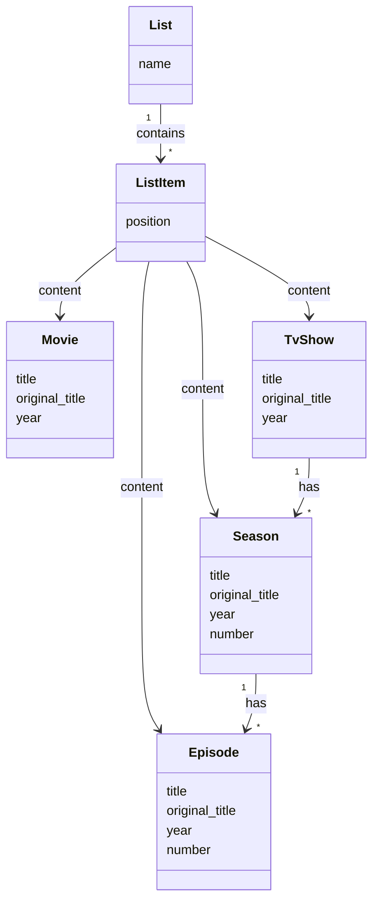

# Media Catalog API

A small Ruby on Rails application that models a media catalog and exposes a public API for retrieving the contents of predefined lists.

The catalog supports four types of content:

* Movies
* TV Shows
* Seasons
* Episodes

Lists can contain any combination of these content types while preserving an explicit position/order.

## Getting started

### Requirements

* Ruby
* Bundler
* SQLite

### Development commands

The project includes a small Makefile with the main development commands:

* `make init` — installs dependencies, prepares the database and loads the sample data.
* `make dev` — starts the Rails development server.
* `make test` — runs the RSpec test suite.
* `make db` — opens the development SQLite database.

### Setup

Run:

```bash
make init
```

Then start the application:

```bash
make dev
```

The API will be available at:

```text
http://localhost:3000
```

### Inspecting the sample data

The sample data is loaded automatically by `make init`.

Since SQLite IDs are database-generated, the list IDs should not be assumed in advance. To see the available lists:

```bash
make db
```

Then:

```sql
SELECT id, name FROM lists;
```

For example, this might return:

```text
1|Top 10
2|Best Movies
```

You can then use one of those IDs to query the API.

## Testing

The test suite is implemented with RSpec and covers:

* Empty lists
* Lists containing different content types
* Ordering by position
* Nested Season and Episode relationships
* Pagination
* Content type filtering
* Invalid content types
* Invalid pagination values
* Missing lists
* API error responses

Run the complete test suite with:

```bash
make test
```

## API

### Get a list

```http
GET /lists/:id
```

The endpoint returns the list metadata, its items in the configured position order, and pagination metadata.

Example:

```bash
curl http://localhost:3000/lists/1
```

An item contains its list-item metadata and a `content` object containing the attributes relevant to that content type.

A list containing a movie returns a response similar to:

```json
{
  "id": 1,
  "name": "Best Movies",
  "items": [
    {
      "id": 1,
      "position": 1,
      "type": "Movie",
      "content": {
        "id": 1,
        "title": "The Matrix",
        "original_title": "The Matrix",
        "year": 1999
      }
    }
  ],
  "pagination": {
    "page": 1,
    "per_page": 10,
    "total": 1
  }
}
```

For nested content, relationships are represented progressively.

An Episode includes its Season, which in turn includes its TV Show:

```json
{
  "id": 3,
  "position": 3,
  "type": "Episode",
  "content": {
    "id": 1,
    "title": "Pilot",
    "original_title": "Pilot",
    "year": 2008,
    "number": 1,
    "season": {
      "id": 1,
      "number": 1,
      "tv_show": {
        "id": 1,
        "title": "Breaking Bad"
      }
    }
  }
}
```

For nested relationships, the API intentionally returns a *summary representation* of the related resource rather than its complete representation. This keeps the response useful without introducing unnecessary duplication or recursive structures.

### Pagination

Pagination is supported through `page` and `per_page`:

```bash
curl "http://localhost:3000/lists/1?page=2&per_page=3"
```

The response includes pagination metadata:

```json
{
  "pagination": {
    "page": 2,
    "per_page": 3,
    "total": 10
  }
}
```

### Filtering by content type

The optional `content_type` parameter filters the contents of a list while preserving their original position order:

```bash
curl "http://localhost:3000/lists/1?content_type=Movie"
```

Supported values are:

* `Movie`
* `TvShow`
* `Season`
* `Episode`

### Combining filtering and pagination

Filtering and pagination can also be combined:

```bash
curl "http://localhost:3000/lists/1?content_type=Movie&page=2&per_page=3"
```

Pagination is applied after filtering, so the total represents the number of items matching the requested content type.

### Error responses

The API returns structured errors when the request cannot be fulfilled, using a consistent format:

```json
{
  "error": {
    "code": "...",
    "message": "..."
  }
}
```

For example, requesting a list that does not exist:

```bash
curl http://localhost:3000/lists/999999
```

returns:

```json
{
  "error": {
    "code": "LIST_NOT_FOUND",
    "message": "List not found"
  }
}
```

Invalid pagination values return a `400 Bad Request` with a descriptive error:

```json
{
  "error": {
    "code": "INVALID_PAGINATION",
    "message": "Page must be a positive integer, but value is foo"
  }
}
```

Invalid content types are handled similarly:

```json
{
  "error": {
    "code": "INVALID_CONTENT_TYPE",
    "message": "Unsupported content type: InvalidType"
  }
}
```

## Domain model

The domain is centered around four content types that can be included in lists.



## Design decisions

### Separate content models

Movies, TV shows, Seasons and Episodes are represented by separate models.

Although they share common attributes such as title, original_title and year, they also have different domain constraints and relationships. Keeping them as separate models allows those constraints to be expressed directly in the domain model.

For example:

* A season belongs to a TV show.
* An Episode belongs to a Season.
* Seasons and Episodes have a `number`.
* Movies do not have those relationships.

### Polymorphic list items

Lists can contain any content type, so `ListItem` uses a polymorphic association:

```text
List → ListItem → Movie
                 → TvShow
                 → Season
                 → Episode
```

This avoids having separate association tables for every content type while keeping the list ordering in one place.

### Unique positions within a list

Each `ListItem` position is unique within a given list.

This guarantees that a list always has a deterministic ordering and avoids ambiguous situations where two items occupy the same position.

### Duplicate content is allowed

The same content may appear multiple times within the same list, provided each occurrence has a different position.

Each `ListItem` represents an independent placement of a piece of content rather than enforcing uniqueness of the referenced content.

### Ordering

The order of a list is represented explicitly by `ListItem.position`.

The API always orders items by this field, including when `content_type` filtering is applied. This means filtering a list does not change the relative order of the remaining items.

### Filtering before pagination

When `content_type` is provided, filtering is applied before pagination.

This ensures that pagination metadata (`total`, `page`, `per_page`) always reflects the filtered result set rather than the original list.

### Stable API contract

The response model was designed with long-term compatibility in mind.

The API exposes a consistent structure across all supported content types and uses nested summary representations for related resources. New functionality is expected to be introduced by adding new attributes rather than changing or removing existing ones whenever possible.

This approach aims to minimise breaking changes for API consumers and reduce the need for versioned endpoints.

### Validation

Pagination parameters and `content_type` are validated explicitly by the `ListContents` use case.

Invalid input results in a structured `400 Bad Request` response rather than silently falling back to default values. Defaults are only applied when the parameters are omitted.

### Error handling

The controller translates domain/use-case errors into HTTP responses, keeping the business logic independent from the HTTP layer.

This also provides a consistent error response format with a machine-readable error code and a human-readable message.